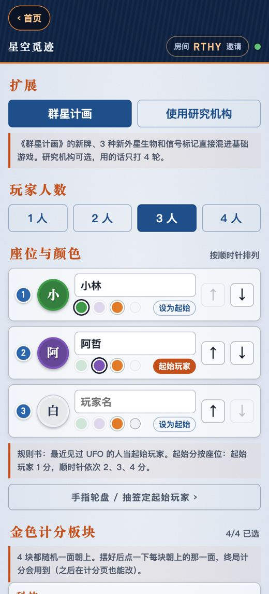
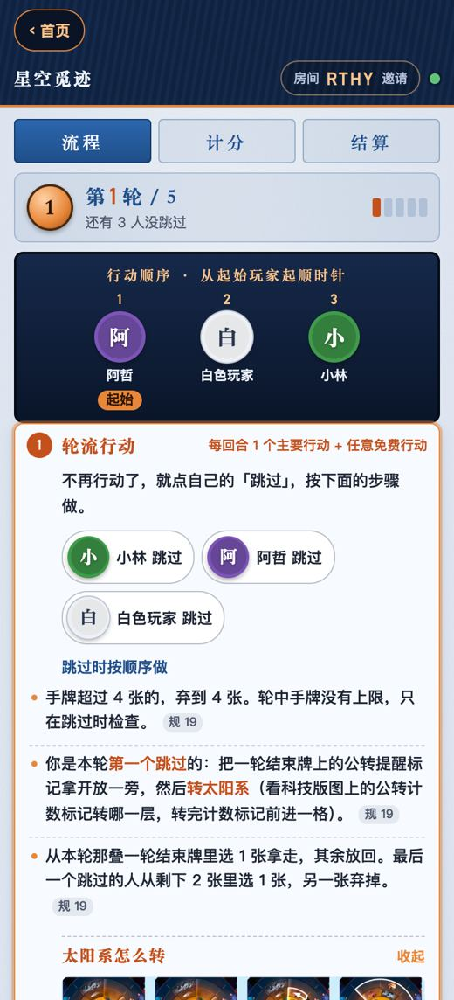
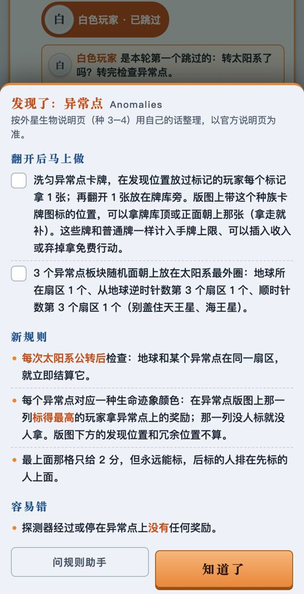
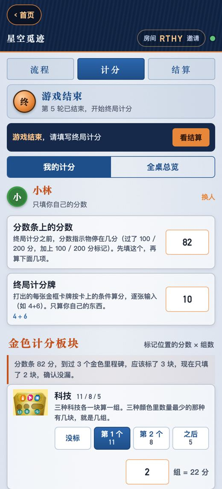
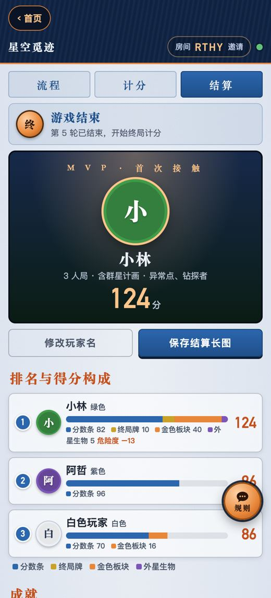

<div align="center">

# 星空觅迹小助手

**开局不漏 · 轮次不乱 · 计分不错**

《星空觅迹》（SETI: Search for Extraterrestrial Intelligence，CGE 2024）线下对局的多人同步工具：布置清单、跳过与轮次提示、外星生物揭晓说明、终局计分，支持扩展《群星计画》（Space Agencies）和单人模式。

一桌人用手机扫码进同一个房间，所有操作实时同步，无需下载、无需注册。地址：https://seti.leisurecat.cloud


</div>

---

## 做什么、不做什么

开发前做了社区调研（BGG 规则区 551 个主题全部抓取、官方 FAQ、B 站讲规视频和评论），原则是：线下用实物更方便的留在线下，繁琐、易错、需要记录的才放到线上。清单和依据见 [docs/调研清单.md](docs/调研清单.md)，完整报告在 [docs/调研/](docs/调研/)，规则笔记（逐条注页码）在 [docs/规则笔记.md](docs/规则笔记.md)。

- **做**：按人数和扩展生成的布置清单、跳过三步和第一个跳过的人转太阳系（附公转示意图）、轮次之间清单、外星生物揭晓时全桌弹出说明、「别忘了」易错规则、终局分项计分（金色计分板块、钻探者危险度、符文族、单人对手）、讲规则页、常见问题、规则助手。
- **不做**：资源和推广计数、分数条实时记分、公转计数（科技版图上有实物标记）、太阳系随机（官方有网页）、抽外星生物、单人对手自动机（brdgm.me 已有）、完整卡牌词典、在线对战。

## 功能一览

### 6 分钟讲规则（/teach）

首页「第一次玩？6 分钟讲规则」，带新人快速开局：讲的人照着念主流程（8 段，每段标了大约几秒），每个重要要素用一句话点到，带下划线的词点一下弹出官方规则书里的图和注释，每段末尾的「问」一点就问规则助手。主流程讲完，再一条条过 18 条「注意事项」（带《群星计画》时 21 条），每条都写好答案，默认收起。顶部可以切换「只玩基础 / 带群星计画」，每台手机记住自己的选择。页面底部是按桌上位置分组的图标速查（51 个）。

图片截自 CGE 官方简体中文版规则书、快速参考和《群星计画》规则书，页脚署名并链接原文。讲稿和注意事项用自己的话写，数据都在 `public/teach.js` 开头。


### 准备：扩展、人数、座位、金色计分板块

勾选《群星计画》；再选是否用研究机构（用的话只打第 2–5 轮）。1–4 人，1 人是单人对手模式（选难度 1–5 星、谁先手或随机）。座位顺时针排好，起始玩家可以跳到「桌游小助手」首页用手指轮盘或抽签定。4 块金色计分板块各点一下朝上的那一面（图片截自规则书），终局计分要用。

「看布置清单」按人数和扩展列出全部摆放步骤：中立里程碑每格几个、一轮结束牌几叠每叠几张、科技每种 4 块都放、起始分按座位、起始资源和第一次插入收入，单人对手和研究机构的额外步骤。每条标规则书页码，点一条勾一条。



### 流程：跳过、公转、轮次之间

「流程」页显示行动顺序（起始玩家每轮左移；单人你和对手轮流先手）。每人一个「跳过」按钮，下面列出跳过时按顺序做的事；第一个跳过的人要转太阳系，有公转示意图和转法说明；已发现异常点时提醒转完检查。全员跳过后列出轮次之间的清单（收入、起始玩家、公转提醒标记、单人目标消耗），第 5 轮后提醒不再拿收入。「别忘了」列出 BGG 上最常被问错的 10 条（含 CGE 2025-12 才正式裁定的“移动力不能存”）。点错可以撤销，断线重连自动追上。



### 外星生物揭晓

某块外星生物版图被发现时，任何人点「发现了新的外星生物」选是哪一个，所有人的手机都会弹出这个种族的说明：翻开后马上做什么、新规则、容易错的地方（含 CGE 的裁定）。基础 5 个、《群星计画》3 个，内容依据官方外星生物说明，用自己的话写。



### 计分：每人在自己手机上填

「我的计分」：分数条上的分数、终局计分牌（逐张输入）、4 块金色计分板块（选标在第 1 个 / 第 2 个 / 之后，填达成几组，自动相乘，条件旁写清怎么数）。发现钻探者时填钻探者牌得分和危险度，自动扣危险度最高者的十分之一（最高是 0 时谁都不扣）；发现符文族时按组输入符文种数。防错提示：分数条分数对应能标几块金色板块、同一块板块的第 1 / 第 2 格被两个人填了。

「全桌总览」一张竖表，没手机的人可以由别人代填。单人另有「对手」页：分数条、没完成的目标（每个 5 分），以及钻探者、符文族的对手计分。



### 结算、往期对局、评价

自动排名，最高分平手共享胜利（规则书原意）。展示得分构成和成就，可以改玩家名、存结算长图，最后给这款游戏打分（提交到桌游小助手首页，game 为 `seti`）。每局结束自动存档，「往期对局」可按玩家名、颜色、外星生物或房间码搜索，有按人数和扩展统计的成绩参照。



### 常见问题（/guide）与规则助手

40 条常见问题，每条附规则书页码、官方 FAQ 或 CGE 在 BGG 的裁定链接；8 个外星生物的说明也在这一页。

每个页面右下角都有「规则」按钮。规则助手只依据本站的讲解稿（`tools/讲解稿.md`）和常见问题（`tools/faq.json`）回答，术语用官方简中版的叫法，也听得懂盗版和社区常见的别名（宣传、环绕、登陆、痕迹）。资料里没有的，模型只回一行「【需联网】+英文搜索词」（以 SETI board game 开头），服务器调 DeepSeek 搜索接口（先搜 BGG，不足 3 条再搜全网），回答固定标「本站资料没有这一条，以下来自网上讨论，本站未核对」并列来源。模型顺序、超时切换和 DeepSeek 不通时先用 Qwen 的做法和系列其他站一致；本站只读匹兹堡助手写在 KV 里的 DeepSeek 状态。

---

## 技术实现

纯前端页面 + Cloudflare Workers，没有构建步骤，没有框架。

| 部分 | 说明 |
|---|---|
| `public/` | 页面：`index.html`、`app.js`、`style.css`、常见问题 `guide.html`、往期对局 `history.html`、讲规则页 `teach.html` + `teach.js`；`img/teach/` 和 `img/gold/` 是规则书截图 |
| `public/logic.js` | 规则与状态逻辑（轮次、跳过、外星生物、计分、钻探者扣分），页面和服务端共用，服务端用 `reduce()` 权威判定 |
| `public/steps.js` | 布置清单、跳过步骤、公转说明、轮次之间、「别忘了」和 8 个外星生物的说明，每条带页码 |
| `src/worker.js` | Cloudflare Worker：建房接口；`Room`（每个房间一个 Durable Object，WebSocket 实时同步）；`Lobby`（首页房间列表）；`Archive`（往期对局和成绩参照）；`/api/chat` 规则助手（流式转发、备用模型切换、联网查找、按 IP 限流，密钥只在服务端） |
| `public/vendor/` | [html2canvas](https://github.com/niklasvh/html2canvas) 1.4.1（MIT），生成结算长图 |
| `tools/` | 讲解稿、常见问题数据、常见问题页生成脚本 |
| `tests/` | 规则单元测试 + Playwright 端到端测试 |

## 本地开发与部署

```bash
wrangler dev --port 8851     # 本地运行，打开 http://localhost:8851
wrangler deploy              # 部署
python3 tools/build_guide.py tools/faq.json public/guide.html   # 改了常见问题后重新生成 guide.html
```

规则助手的密钥由账号主人自己设置：`wrangler secret put DEEPSEEK_API_KEY --name seti-helper`。图片缓存 7 天，替换同名图片时用户最多要等 7 天才看到新图。

## 测试

需要本机安装 Chrome，以及 `npm i playwright-core`。

```bash
node tests/test_logic.mjs                                               # 规则单元测试（不需要服务器）
node tests/test_room.mjs    http://localhost:8851/ ./shots               # 双手机 3 人局 + 群星计画：5 轮流程、撤销、外星生物弹窗、计分防错、结算、长图
node tests/test_history.mjs http://localhost:8851/ ./shots --many-rooms  # 往期对局存档、搜索、成绩参照；房间多时首页按钮仍在首屏
node tests/test_review.mjs  http://localhost:8851/ ./shots               # 结算页评价卡（总入口接口用 page.route 拦截，不写线上数据）
node tests/test_teach.mjs   http://localhost:8851/ ./shots               # 讲规则页：段落、要素、术语弹窗、两种模式、注意事项、图标速查、手机宽度
node tests/test_chat.mjs    http://localhost:8851/ ./shots --no-key      # 规则助手界面（wrangler dev 不带密钥）
node tests/test_chat.mjs    http://localhost:8851/ ./shots --fake-key    # 请求校验、上游出错、限流
node tests/test_chat.mjs    http://localhost:8851/ ./shots --mock-upstream   # 备用模型切换
node tests/test_chat.mjs    http://localhost:8851/ ./shots --mock-web    # 联网查找
node tests/test_history.mjs https://seti.leisurecat.cloud/ ./shots --live    # 线上冒烟：打完一局再撤销，不留记录
node tests/test_chat.mjs    https://seti.leisurecat.cloud/ ./shots --live    # 规则助手线上实问一次
```

`--fake-key`、`--mock-upstream`、`--mock-web` 需要 `wrangler dev --port 8851 --var DEEPSEEK_API_KEY:fake --var DEEPSEEK_BASE:http://127.0.0.1:8842 --var CHAT_CF_MODEL:@cf/none/missing`，每组之间隔一分钟（每分钟 8 问的限流）。打完整局的测试会在往期对局里留下记录，所以请对本地 `wrangler dev` 运行；线上只跑 `--live`。

## 声明

- 本项目是非官方的玩家工具，不提供游戏本体，线下对局仍需实体《星空觅迹》。
- 规则依据 CGE 官方规则书（简体中文版 2024-10 版，与英文版页码一致）、外星生物说明、快速参考、官方 FAQ（BGG 帖子 3392878）和《群星计画》规则书；讲解、常见问题和外星生物说明都是用自己的话整理，有疑问以官方资料为准。
- 游戏名称、规则、首页的游戏盒封面，以及讲规则页、金色计分板块的图片（截自官方规则书和快速参考）版权归 Czech Games Edition 所有。
- 代码以 [MIT](LICENSE) 许可开源。
